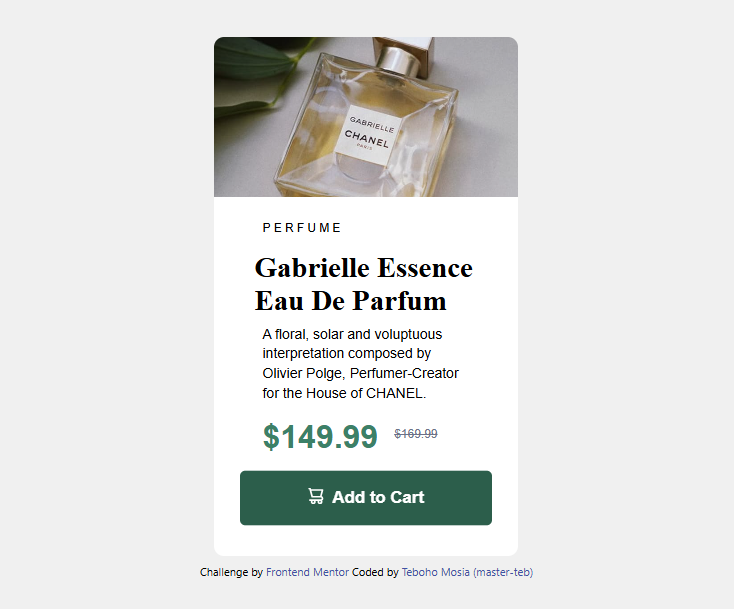

# Frontend Mentor - Product preview card component solution

This is a solution to the [Product preview card component challenge on Frontend Mentor](https://www.frontendmentor.io/challenges/product-preview-card-component-GO7UmttRfa). Frontend Mentor challenges help you improve your coding skills by building realistic projects. 

## Table of contents

- [Overview](#overview)
  - [The challenge](#the-challenge)
  - [Screenshot](#screenshot)
  - [Links](#links)
- [My process](#my-process)
  - [Built with](#built-with)
  - [What I learned](#what-i-learned)
  - [Continued development](#continued-development)
  - [Useful resources](#useful-resources)
  - [AI Collaboration](#ai-collaboration)
- [Author](#author)
- [Acknowledgments](#acknowledgments)

## Overview

### The challenge

Users should be able to:

- View the optimal layout depending on their device's screen size - check
- See hover and focus states for interactive elements -check

### Screenshot

### Links

- Solution URL: [Frontend Mentor](https://github.com/master-teb/product-preview-card-component)
- Live Site URL: [GitHub](https://master-teb.github.io/product-preview-card-component/)

## My process

### Built with

- Semantic HTML5 markup
- CSS custom properties
- Flexbox
- CSS Grid
- Mobile-first workflow

### What I learned

I learned to use both flexbox and CSS grid. i finally got my first fully responsive page!

### Continued development

i just want to play more with the CSS Grid and do the 'holy grail' 

### Useful resources

- [GitHub Copilot](https://www.github.com) - This helped me with understanding what i was doing. forinstance, at one point the card was up an to the left, and Copilot helped figure why and i fixed it.

### AI Collaboration

Describe how you used AI tools (if any) during this project. This helps demonstrate your ability to work effectively with AI assistants.

- GitHub Copilot
- Please read 'Useful resources'.

## Author

- GitHub - [@master-teb](https://www.your-site.com)
- Frontend Mentor - [master-teb](https://www.frontendmentor.io/profile/master-teb)
- Instagram - [@webmasterteb](https://www.instagram.com/webmasterteb)

## Acknowledgments

thank you to:

- Frontend Mentor for this challenge
- To me, for applying what i learned. 
